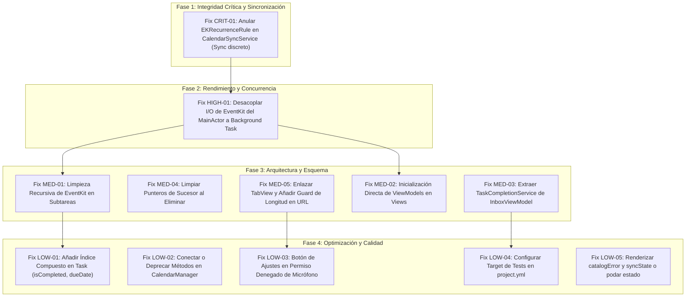

# Task-Flow Code Review: Master Audit Report
**Repositorio**: Task-Flow  
**Ruta**: `/Users/eduardotorres/Developer/XCodes/Task-Flow`  
**Fecha de Auditoría**: 24 de Agosto de 2026  
**Auditor**: Antigravity Senior Security & Software Architect  
**Scope**: Código fuente completo (`App/`, `Models/`, `ViewModels/`, `Views/`, `Services/`, `Shared/`, `Widget/`, `Extensions/`, `Task-Flow.xcodeproj`, `project.yml`, `PrivacyInfo.xcprivacy`)

---

## 1. Resumen Ejecutivo (Executive Summary)

Se ha ejecutado una **Auditoría Técnica y de Seguridad Integral (Full Code Review)** sobre el 100% de la base de código de **Task-Flow** (Swift 6, iOS 27.0, SwiftData, EventKit, FoundationModels / Apple Intelligence, SpeechAnalyzer / SpeechTranscriber, WidgetKit).

La evaluación ha cubierto seis dimensiones críticas:
1. **Seguridad y Privacidad (Security & Privacy)**: Permisos TCC, Sandboxing de App Group, Deep Linking, Prompt Injection, Aislamiento On-Device de IA y Audio, Telemetría.
2. **Bugs y Lógica de Negocio (Business Logic & Data Loss)**: Mecánicas de recurrencia, sincronización bidireccional EventKit, cadenas de sucesores, análisis de lenguaje natural (NLP).
3. **Esquema de Base de Datos (Database Schema & SwiftData Integrity)**: Entidades, relaciones inversas, reglas de cascada (`.cascade`/`.nullify`), índices B-Tree, persistencia cross-target.
4. **Arquitectura y Patrones (Architecture & Concurrency)**: MVVM con `@Observable`, Swift 6 Strict Concurrency (`complete`), aislamiento de actores (`@MainActor`, `nonisolated`), acoplamiento y SRP.
5. **Rendimiento y Concurrencia (Performance & Threading)**: Bloqueo de hilo principal en I/O de EventKit, queries N+1, serialización en background, formateadores estáticos.
6. **Código Muerto y Smells (Dead Code & Smells)**: Métodos públicos huérfanos, estado no renderizado, directorios vacíos, configuración de tests.

### Diagnóstico General y Nivel de Madurez
- **Aislamiento de Privacidad On-Device (Sobresaliente)**: Cero código de red (`URLSession`, `Network`, `WebKit`). Dictado local estricto (`SpeechAnalyzer`) y modelos locales (`SystemLanguageModel.default`).
- **Concurrencia Swift 6 (Excelente)**: Cumplimiento total de concurrencia estricta (`SWIFT_STRICT_CONCURRENCY: complete`). Callbacks en tiempo real (`AVAudioNodeTapBlock`, `requestAuthorization`) aislados con `nonisolated static` para prevenir traps `SIGTRAP`.
- **Riesgo Crítico Detectado**: Se mantiene un **fallo crítico de diseño en la sincronización de recurrencia** (`CRIT-01`), donde la materialización discreta de tareas en SwiftData combinada con reglas `EKRecurrenceRule` genera series duplicadas exponenciales en Apple Calendar.

---

## 2. Matriz Maestra de Hallazgos por Severidad Real

| ID | Título del Hallazgo | Ubicación en Código | Severidad | Categoría | Estado | CWE / Impacto |
| :--- | :--- | :--- | :---: | :--- | :---: | :--- |
| **CRIT-01** | **Mapeo Dual de Recurrencia Genera Series Duplicadas Exponenciales en Apple Calendar** | [`Services/CalendarSyncService.swift:88-93`](file:///Users/eduardotorres/Developer/XCodes/Task-Flow/Services/CalendarSyncService.swift#L88-L93), [`ViewModels/InboxViewModel.swift:211-222`](file:///Users/eduardotorres/Developer/XCodes/Task-Flow/ViewModels/InboxViewModel.swift#L211-L222) | 🚨 **CRITICAL** | Lógica de Negocio / Pérdida de Datos | **OPEN** | CWE-400 / Corrupción y polución exponencial de Calendar |
| **HIGH-01** | **I/O Sincrónico de EventKit e IPC Mach Bloqueando el Hilo UI (`@MainActor`)** | [`Services/CalendarSyncService.swift:96,122`](file:///Users/eduardotorres/Developer/XCodes/Task-Flow/Services/CalendarSyncService.swift#L96), [`Services/EventKitService.swift:66`](file:///Users/eduardotorres/Developer/XCodes/Task-Flow/Services/EventKitService.swift#L66) | 🔴 **HIGH** | Rendimiento y Concurrencia | **OPEN** | CWE-400 / UI Freeze y riesgo de Watchdog ANR (0x8badf00d) |
| **HIGH-02** | **Declaración de Permisos TCC Sobredimensionada (`NSRemindersFullAccessUsageDescription`)** | [`project.yml:40-47`](file:///Users/eduardotorres/Developer/XCodes/Task-Flow/project.yml#L40-L47), [`Task-Flow/Info.plist:32-37`](file:///Users/eduardotorres/Developer/XCodes/Task-Flow/Task-Flow/Info.plist#L32-L37) | 🔴 **HIGH** | Seguridad y Cumplimiento | **RESOLVED** (Commit `bcbe827`) | CWE-276 / Prevención de rechazo en App Store (5.1.1) |
| **HIGH-03** | **Query y Escritura a Disco Sincrónica en `@MainActor` al Suspender la App** | [`Services/WidgetSnapshotPublisher.swift:37-40`](file:///Users/eduardotorres/Developer/XCodes/Task-Flow/Services/WidgetSnapshotPublisher.swift#L37-L40), [`App/TaskFlowApp.swift:96-100`](file:///Users/eduardotorres/Developer/XCodes/Task-Flow/App/TaskFlowApp.swift#L96-L100) | 🔴 **HIGH** | Rendimiento y Ciclo de Vida | **RESOLVED** (Commit `bc61ab3`) | CWE-400 / Dispatch de I/O en background thread |
| **MED-01** | **Eliminación en Cascada de Subtareas Omite Desincronización en EventKit** | [`Models/Task.swift:103`](file:///Users/eduardotorres/Developer/XCodes/Task-Flow/Models/Task.swift#L103), [`Views/Tasks/TaskEditView.swift:76-80`](file:///Users/eduardotorres/Developer/XCodes/Task-Flow/Views/Tasks/TaskEditView.swift#L76-L80) | 🟡 **MEDIUM** | Esquema / Sincronización | **OPEN** | CWE-404 / Eventos huérfanos permanentes en Calendar |
| **MED-02** | **Inicialización Lazy de ViewModels Opcionales `@State` en `.onAppear`** | [`Views/Inbox/SmartInboxView.swift:40,84-86`](file:///Users/eduardotorres/Developer/XCodes/Task-Flow/Views/Inbox/SmartInboxView.swift#L40), [`Views/Completed/CompletedTasksView.swift:30,56-58`](file:///Users/eduardotorres/Developer/XCodes/Task-Flow/Views/Completed/CompletedTasksView.swift#L30) | 🟡 **MEDIUM** | Arquitectura y Patrones | **OPEN** | CWE-1076 / Doble ciclo de layout y retraso en render |
| **MED-03** | **Violación de Responsabilidad Única (SRP): Acoplamiento a `InboxViewModel`** | [`ViewModels/InboxViewModel.swift:177-254`](file:///Users/eduardotorres/Developer/XCodes/Task-Flow/ViewModels/InboxViewModel.swift#L177-L254), [`Views/Completed/CompletedTasksView.swift:57`](file:///Users/eduardotorres/Developer/XCodes/Task-Flow/Views/Completed/CompletedTasksView.swift#L57) | 🟡 **MEDIUM** | Arquitectura y Patrones | **OPEN** | Acoplamiento innecesario y estado sobredimensionado |
| **MED-04** | **Puntero Huérfano (`spawnedSuccessorID`) al Eliminar Manualmente Tarea Sucesora** | [`ViewModels/InboxViewModel.swift:235-254`](file:///Users/eduardotorres/Developer/XCodes/Task-Flow/ViewModels/InboxViewModel.swift#L235-L254), [`Views/Tasks/TaskEditView.swift:76-80`](file:///Users/eduardotorres/Developer/XCodes/Task-Flow/Views/Tasks/TaskEditView.swift#L76-L80) | 🟡 **MEDIUM** | Lógica de Negocio | **OPEN** | CWE-672 / Ruptura de cadena de des-completado |
| **MED-05** | **Desincronización de Pestañas en Deep Link y Falta de Límite de Longitud** | [`Shared/TaskFlowSharedStore.swift:145-149`](file:///Users/eduardotorres/Developer/XCodes/Task-Flow/Shared/TaskFlowSharedStore.swift#L145-L149), [`App/DeepLinkCoordinator.swift:16-25`](file:///Users/eduardotorres/Developer/XCodes/Task-Flow/App/DeepLinkCoordinator.swift#L16-L25), [`Views/Components/RootTabView.swift:19-26`](file:///Users/eduardotorres/Developer/XCodes/Task-Flow/Views/Components/RootTabView.swift#L19-L26) | 🟡 **MEDIUM** | Navegación y Seguridad | **OPEN** | Tareas en segundo plano invisibles en Deep Links |
| **LOW-01** | **Falta de Índice Compuesto en Predicados de Filtro Frecuentes** | [`Models/Task.swift:15`](file:///Users/eduardotorres/Developer/XCodes/Task-Flow/Models/Task.swift#L15) | 🔵 **LOW** | Esquema de Base de Datos | **OPEN** | Table scans en consultas de Inbox y Widget |
| **LOW-02** | **Código Muerto en `CalendarManager` (`syncAllTasks`, `importCalendarEvents`, `detectConflicts`)** | [`Services/CalendarManager.swift:168-180, 203-227, 240-250`](file:///Users/eduardotorres/Developer/XCodes/Task-Flow/Services/CalendarManager.swift#L168-L180) | 🔵 **LOW** | Código Muerto / Smells | **OPEN** | Superficie de API pública no utilizada |
| **LOW-03** | **Fallo Silencioso en Denegación de Permiso de Reconocimiento de Voz** | [`Views/Components/VoiceInputButton.swift:47-48`](file:///Users/eduardotorres/Developer/XCodes/Task-Flow/Views/Components/VoiceInputButton.swift#L47-L48) | 🔵 **LOW** | UX / Seguridad | **OPEN** | Flujo de usuario degradado sin acceso directo a Ajustes |
| **LOW-04** | **Ausencia de Target de Tests Unitarios Automatizados en `project.yml`** | [`project.yml:19-61`](file:///Users/eduardotorres/Developer/XCodes/Task-Flow/project.yml#L19-L61), [`CLAUDE.md:49`](file:///Users/eduardotorres/Developer/XCodes/Task-Flow/CLAUDE.md#L49) | 🔵 **LOW** | Calidad / Testing | **OPEN** | Vulnerabilidad ante regresiones lógicas |
| **LOW-05** | **Estado Huérfano No Renderizado (`catalogError` y `syncState`)** | [`ViewModels/InboxViewModel.swift:52`](file:///Users/eduardotorres/Developer/XCodes/Task-Flow/ViewModels/InboxViewModel.swift#L52), [`Services/CalendarManager.swift:64`](file:///Users/eduardotorres/Developer/XCodes/Task-Flow/Services/CalendarManager.swift#L64) | 🔵 **LOW** | UX / Código Muerto | **OPEN** | Errores de IA y estado de sync invisibles para el usuario |

---

## 3. Resumen de Módulos de Auditoría Detallados

Para consultar el análisis técnico pormenorizado, pruebas de concepto y diffs de código de cada dominio, revise los siguientes documentos en `.audit/`:

1. [**01_SECURITY_AND_PRIVACY.md**](file:///Users/eduardotorres/Developer/XCodes/Task-Flow/.audit/01_SECURITY_AND_PRIVACY.md) — Análisis de TCC, Sandboxing de App Group, Deep Links, Inferencia Local y Privacidad.
2. [**02_BUSINESS_LOGIC_AND_DATA_LOSS.md**](file:///Users/eduardotorres/Developer/XCodes/Task-Flow/.audit/02_BUSINESS_LOGIC_AND_DATA_LOSS.md) — Mecánicas de Recurrencia, Duplicación EventKit, Cadenas de Tareas y NLP.
3. [**03_DATABASE_SCHEMA.md**](file:///Users/eduardotorres/Developer/XCodes/Task-Flow/.audit/03_DATABASE_SCHEMA.md) — Modelos SwiftData, Relaciones Inversas, Cascada de Subtareas e Índices B-Tree.
4. [**04_ARCHITECTURE_AND_PATTERNS.md**](file:///Users/eduardotorres/Developer/XCodes/Task-Flow/.audit/04_ARCHITECTURE_AND_PATTERNS.md) — MVVM, Ciclos de Vida SwiftUI, Principio SRP y Strict Concurrency.
5. [**05_PERFORMANCE_AND_THREADS.md**](file:///Users/eduardotorres/Developer/XCodes/Task-Flow/.audit/05_PERFORMANCE_AND_THREADS.md) — I/O Bloqueante en Hilo Principal, Optimización de Consultas y Snapshots de Widget.
6. [**06_DEAD_CODE_AND_CODE_SMELLS.md**](file:///Users/eduardotorres/Developer/XCodes/Task-Flow/.audit/06_DEAD_CODE_AND_CODE_SMELLS.md) — Métodos Públicos Huérfanos, Variables No Renderizadas y Cobertura de Tests.
7. [**07_POST_FIX_VERIFICATION_REPORT.md**](file:///Users/eduardotorres/Developer/XCodes/Task-Flow/.audit/07_POST_FIX_VERIFICATION_REPORT.md) — Plan de Remediación Priorizado en 4 Fases y Checklist de Verificación.

---

## 4. Hoja de Ruta Priorizada de Remediación

