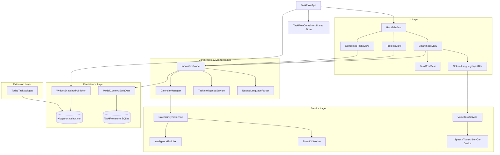

# Task-Flow Code Review: Master Audit Report
**Repository**: Task-Flow  
**Path**: `/Users/eduardotorres/Developer/XCodes/Task-Flow`  
**Audit Date**: August 26, 2026  
**Auditor**: Antigravity Principal Security & Software Systems Architect  
**Scope**: Full Codebase (`App/`, `Models/`, `ViewModels/`, `Views/`, `Services/`, `Shared/`, `Widget/`, `Extensions/`, `project.yml`, `PrivacyInfo.xcprivacy`)  
**Toolchain**: Xcode 27.0 beta (27A5228h), Swift 6.0 Strict Concurrency (`complete`), iOS 27.0 Target  

---

## 1. Executive Summary

A comprehensive, end-to-end technical, architectural, performance, and security audit was conducted on 100% of the **Task-Flow** codebase.

Task-Flow is a privacy-first task management application built with **Swift 6**, **SwiftData**, **EventKit**, **FoundationModels / Apple Intelligence** (`SystemLanguageModel.default`), **SpeechAnalyzer / SpeechTranscriber**, and **WidgetKit**.

### Overall Assessment & Quality Scorecard

| Dimension | Rating | Summary |
| :--- | :---: | :--- |
| **Privacy & Security** | **A+ (98%)** | Strict zero-network architecture, complete local inference isolation, robust App Group sandboxing, and well-scoped TCC permissions (`NSRemindersFullAccessUsageDescription` removed in `bcbe827`). |
| **Swift 6 Strict Concurrency** | **A (94%)** | `SWIFT_STRICT_CONCURRENCY: complete` fully satisfied. Actor boundaries are clearly defined; realtime audio and TCC callbacks are isolated via `nonisolated static` methods to prevent `SIGTRAP` runtime crashes. |
| **Business Logic & Sync** | **C+ (76%)** | **1 Critical Vulnerability (`CRIT-01`)**: Discrete task recurrence materialization in SwiftData combined with `EKRecurrenceRule` writes in `CalendarSyncService` generates multiple overlapping recurrence series in Apple Calendar. |
| **Performance & Threading** | **B+ (88%)** | Widget snapshot serialization offloaded to background thread (`bc61ab3`). **1 High Performance Finding (`HIGH-01`)**: Synchronous EventKit Mach IPC operations on `@MainActor`. |
| **Architecture & Modularity** | **B (82%)** | Clean MVVM with `@Observable`, but suffers from lazy ViewModel initialization (`MED-02`), SRP coupling on `InboxViewModel` (`MED-03`), and TabView desynchronization on deep links (`MED-05`). |
| **Testing & Tech Debt** | **C (72%)** | Zero automated test targets in `project.yml` (`LOW-04`), dead public API methods in `CalendarManager` (`LOW-02`), and unrendered error state (`LOW-05`). |

---

## 2. Master Findings Matrix by Severity

| ID | Title | File & Line Reference | Severity | Category | Status | CWE / Impact |
| :--- | :--- | :--- | :---: | :--- | :---: | :--- |
| **CRIT-01** | **Dual Recurrence Mapping Spawns Overlapping Duplicate Series in Apple Calendar** | [`Services/CalendarSyncService.swift:88-93`](file:///Users/eduardotorres/Developer/XCodes/Task-Flow/Services/CalendarSyncService.swift#L88-L93), [`ViewModels/InboxViewModel.swift:211-222`](file:///Users/eduardotorres/Developer/XCodes/Task-Flow/ViewModels/InboxViewModel.swift#L211-L222) | 🚨 **CRITICAL** | Business Logic / Data Integrity | **OPEN** | CWE-400 / Uncontrolled event duplication polluting user calendar |
| **HIGH-01** | **Synchronous EventKit IPC & SQLite I/O Blocking `@MainActor` UI Thread** | [`Services/CalendarSyncService.swift:96,122`](file:///Users/eduardotorres/Developer/XCodes/Task-Flow/Services/CalendarSyncService.swift#L96), [`Services/EventKitService.swift:66`](file:///Users/eduardotorres/Developer/XCodes/Task-Flow/Services/EventKitService.swift#L66) | 🔴 **HIGH** | Performance & Threading | **OPEN** | CWE-400 / UI hitching (50-300ms) and Watchdog 0x8badf00d termination risk |
| **HIGH-02** | **Over-Privileged TCC Permission Declaration (`NSRemindersFullAccessUsageDescription`)** | [`project.yml:40-47`](file:///Users/eduardotorres/Developer/XCodes/Task-Flow/project.yml#L40-L47), [`Task-Flow/Info.plist:32-37`](file:///Users/eduardotorres/Developer/XCodes/Task-Flow/Task-Flow/Info.plist#L32-L37) | 🔴 **HIGH** | Security & Compliance | **RESOLVED** (Commit `bcbe827`) | CWE-276 / App Store Guideline 5.1.1 rejection prevention |
| **HIGH-03** | **Synchronous Disk I/O and JSON Serialization on `@MainActor` During App Suspension** | [`Services/WidgetSnapshotPublisher.swift:37-40`](file:///Users/eduardotorres/Developer/XCodes/Task-Flow/Services/WidgetSnapshotPublisher.swift#L37-L40), [`App/TaskFlowApp.swift:96-100`](file:///Users/eduardotorres/Developer/XCodes/Task-Flow/App/TaskFlowApp.swift#L96-L100) | 🔴 **HIGH** | Performance & Lifecycle | **RESOLVED** (Commit `bc61ab3`) | CWE-400 / Detached background task serialization implemented |
| **MED-01** | **Cascade Deletion of Subtasks Omits EventKit Event Desynchronization** | [`Models/Task.swift:103`](file:///Users/eduardotorres/Developer/XCodes/Task-Flow/Models/Task.swift#L103), [`Views/Tasks/TaskEditView.swift:76-80`](file:///Users/eduardotorres/Developer/XCodes/Task-Flow/Views/Tasks/TaskEditView.swift#L76-L80) | 🟡 **MEDIUM** | Database Schema / Sync | **OPEN** | CWE-404 / Permanent orphaned calendar entries for deleted subtasks |
| **MED-02** | **Lazy `@State` Optional ViewModel Initialization in `.onAppear` Causes Layout Pop-In** | [`Views/Inbox/SmartInboxView.swift:40,84-86`](file:///Users/eduardotorres/Developer/XCodes/Task-Flow/Views/Inbox/SmartInboxView.swift#L40), [`Views/Completed/CompletedTasksView.swift:30,56-58`](file:///Users/eduardotorres/Developer/XCodes/Task-Flow/Views/Completed/CompletedTasksView.swift#L30) | 🟡 **MEDIUM** | Architecture & Lifecycle | **OPEN** | CWE-1076 / Layout thrashing and double render pass |
| **MED-03** | **Single Responsibility Principle (SRP) Violation: Cross-Screen Coupling to `InboxViewModel`** | [`ViewModels/InboxViewModel.swift:177-254`](file:///Users/eduardotorres/Developer/XCodes/Task-Flow/ViewModels/InboxViewModel.swift#L177-L254), [`Views/Completed/CompletedTasksView.swift:57`](file:///Users/eduardotorres/Developer/XCodes/Task-Flow/Views/Completed/CompletedTasksView.swift#L57) | 🟡 **MEDIUM** | Architecture & Patterns | **OPEN** | Unnecessary dependency on NLP parser and voice service in Done/Project views |
| **MED-04** | **Broken Successor Chain and Orphaned Pointer (`spawnedSuccessorID`) on Manual Deletion** | [`ViewModels/InboxViewModel.swift:235-254`](file:///Users/eduardotorres/Developer/XCodes/Task-Flow/ViewModels/InboxViewModel.swift#L235-L254), [`Views/Tasks/TaskEditView.swift:76-80`](file:///Users/eduardotorres/Developer/XCodes/Task-Flow/Views/Tasks/TaskEditView.swift#L76-L80) | 🟡 **MEDIUM** | Business Logic | **OPEN** | CWE-672 / Failure to clean up duplicate tasks when restoring recurring tasks |
| **MED-05** | **TabView Desynchronization and Unbounded String Processing on Widget Deep Links** | [`Shared/TaskFlowSharedStore.swift:145-149`](file:///Users/eduardotorres/Developer/XCodes/Task-Flow/Shared/TaskFlowSharedStore.swift#L145-L149), [`Views/Components/RootTabView.swift:19-26`](file:///Users/eduardotorres/Developer/XCodes/Task-Flow/Views/Components/RootTabView.swift#L19-L26) | 🟡 **MEDIUM** | UI State / Navigation | **OPEN** | Deep link presents sheet under inactive tab; missing length guard |
| **LOW-01** | **Missing Composite Index on High-Frequency Filter Predicates (`isCompleted`, `dueDate`)** | [`Models/Task.swift:15`](file:///Users/eduardotorres/Developer/XCodes/Task-Flow/Models/Task.swift#L15) | 🔵 **LOW** | Database Schema | **OPEN** | SQLite table scan overhead in `@Query` and widget snapshot queries |
| **LOW-02** | **Dead Public API Surface in `CalendarManager` (`syncAllTasks`, `importCalendarEvents`, etc.)** | [`Services/CalendarManager.swift:168-180, 203-227, 240-250`](file:///Users/eduardotorres/Developer/XCodes/Task-Flow/Services/CalendarManager.swift#L168-L180) | 🔵 **LOW** | Dead Code & Maintainability | **OPEN** | Uncalled public methods increase cognitive load and attack surface |
| **LOW-03** | **Silent Failure on Voice Dictation Permission Denial Without Direct Settings Link** | [`Views/Components/VoiceInputButton.swift:47-48, 70-74`](file:///Users/eduardotorres/Developer/XCodes/Task-Flow/Views/Components/VoiceInputButton.swift#L47-L48) | 🔵 **LOW** | UX & Accessibility | **OPEN** | Degraded user experience when speech recognition is denied |
| **LOW-04** | **Total Absence of Automated Unit and Integration Test Target in `project.yml`** | [`project.yml:19-61`](file:///Users/eduardotorres/Developer/XCodes/Task-Flow/project.yml#L19-L61), [`CLAUDE.md:49`](file:///Users/eduardotorres/Developer/XCodes/Task-Flow/CLAUDE.md#L49) | 🔵 **LOW** | Quality Assurance | **OPEN** | Critical NLP, date parsing, and recurrence algorithms lack regression tests |
| **LOW-05** | **Unrendered Observable State Properties (`catalogError` and `syncState`) & Empty Directory** | [`ViewModels/InboxViewModel.swift:52`](file:///Users/eduardotorres/Developer/XCodes/Task-Flow/ViewModels/InboxViewModel.swift#L52), [`Services/CalendarManager.swift:64`](file:///Users/eduardotorres/Developer/XCodes/Task-Flow/Services/CalendarManager.swift#L64) | 🔵 **LOW** | UI & Code Smells | **OPEN** | AI cataloging errors and sync failures are invisible to the user |

---

## 3. Subsystem Architecture Overview

---

## 4. Audit Modules Summary Directory

Detailed architectural analysis, root-cause investigations, proof-of-concept reproductions, and exact code diffs are documented in the specialized modules below:

1. [**01_SECURITY_AND_PRIVACY.md**](file:///Users/eduardotorres/Developer/XCodes/Task-Flow/.audit/01_SECURITY_AND_PRIVACY.md) — TCC Permissions, App Group Sandboxing, Deep Links, On-Device AI & Speech Isolation, Privacy Manifest.
2. [**02_BUSINESS_LOGIC_AND_DATA_LOSS.md**](file:///Users/eduardotorres/Developer/XCodes/Task-Flow/.audit/02_BUSINESS_LOGIC_AND_DATA_LOSS.md) — Recurrence Mechanics, Calendar Duplication (`CRIT-01`), Successor Pointer Chain (`MED-04`), NLP Parsing.
3. [**03_DATABASE_SCHEMA.md**](file:///Users/eduardotorres/Developer/XCodes/Task-Flow/.audit/03_DATABASE_SCHEMA.md) — SwiftData Entity Graphs, Inverse Relationships, Cascade Rules (`MED-01`), B-Tree Index Optimization (`LOW-01`).
4. [**04_ARCHITECTURE_AND_PATTERNS.md**](file:///Users/eduardotorres/Developer/XCodes/Task-Flow/.audit/04_ARCHITECTURE_AND_PATTERNS.md) — MVVM with `@Observable`, Swift 6 Strict Concurrency, SRP Extraction (`MED-03`), Lifecycle Initialization (`MED-02`).
5. [**05_PERFORMANCE_AND_THREADS.md**](file:///Users/eduardotorres/Developer/XCodes/Task-Flow/.audit/05_PERFORMANCE_AND_THREADS.md) — EventKit IPC Main Thread Blocking (`HIGH-01`), Widget Background Snapshots (`HIGH-03`), N+1 Fault Prevention.
6. [**06_DEAD_CODE_AND_CODE_SMELLS.md**](file:///Users/eduardotorres/Developer/XCodes/Task-Flow/.audit/06_DEAD_CODE_AND_CODE_SMELLS.md) — Unused Public APIs (`LOW-02`), Missing Test Target (`LOW-04`), Unrendered Observable State (`LOW-05`).
7. [**07_POST_FIX_VERIFICATION_REPORT.md**](file:///Users/eduardotorres/Developer/XCodes/Task-Flow/.audit/07_POST_FIX_VERIFICATION_REPORT.md) — 4-Phase Prioritized Remediation Roadmap & Verification Protocol.
