# Audit Module 01: Security, Privacy & Entitlements
**Repository**: Task-Flow  
**Path**: `/Users/eduardotorres/Developer/XCodes/Task-Flow`  
**Audit Date**: August 26, 2026  
**Auditor**: Antigravity Principal Security & Software Systems Architect  
**Scope**: TCC Permissions, App Group Sandboxing, Deep Linking, On-Device AI & Speech Isolation, Privacy Manifest (`PrivacyInfo.xcprivacy`), Logging & Telemetry  

---

## 1. Executive Summary

Task-Flow implements a rigorous on-device privacy architecture designed to guarantee that no user data ever leaves the device.

### Core Security & Privacy Invariants Verified:
1. **Strict Zero-Network Architecture**: The codebase contains zero imports or references to `URLSession`, `Network.framework`, `WebKit`, `CFNetwork`, or third-party networking SDKs.
2. **On-Device Artificial Intelligence**: Task cataloging leverages Apple Intelligence via `SystemLanguageModel.default` (`FoundationModels`). The remote `PrivateCloudComputeLanguageModel` is strictly avoided.
3. **On-Device Speech Recognition**: Voice input uses `SpeechAnalyzer` and `SpeechTranscriber` with local assets verified via `AssetInventory`. Unlike legacy `SFSpeechRecognizer`, no server-side transcription path exists.
4. **App Group Sandboxing**: Persistence and snapshot sharing use `group.com.eduardotorres.Task-Flow` with proper entitlement definitions across the main app and widget extension.
5. **Apple Privacy Manifest**: `PrivacyInfo.xcprivacy` correctly declares `NSPrivacyTracking: false`, empty collected data arrays, and `CA92.1` for `UserDefaults`.

---

## 2. Detailed Security Findings

### [HIGH-02] Over-Privileged TCC Permission Declaration (`NSRemindersFullAccessUsageDescription`) — RESOLVED
- **Severity**: 🔴 **HIGH**
- **Location**: [`project.yml:40-47`](file:///Users/eduardotorres/Developer/XCodes/Task-Flow/project.yml#L40-L47), [`Task-Flow/Info.plist:32-37`](file:///Users/eduardotorres/Developer/XCodes/Task-Flow/Task-Flow/Info.plist#L32-L37)
- **CWE**: CWE-276 (Incorrect Default Permissions / Over-Privileged Manifest)
- **Status**: ✅ **VERIFIED RESOLVED** (Commit `bcbe827`)

#### Root Cause & Resolution Analysis
In earlier releases, `project.yml` and `Task-Flow/Info.plist` declared `NSRemindersFullAccessUsageDescription`. However, Task-Flow does not interact with `EKEntityType.reminder` anywhere in the codebase (it synchronizes only with Calendar `EKEntityType.event`). Under App Store Review Guideline 5.1.1, requesting unused permissions is grounds for immediate rejection.

In commit `bcbe827`, `NSRemindersFullAccessUsageDescription` was removed. The application now requests only its necessary entitlements:
1. `NSCalendarsFullAccessUsageDescription`: For EventKit calendar synchronization.
2. `NSMicrophoneUsageDescription`: For local voice capture.
3. `NSSpeechRecognitionUsageDescription`: For on-device speech transcription.

---

### [MED-05] Unbounded String Parsing in Deep Link Routing & TabView Desynchronization
- **Severity**: 🟡 **MEDIUM**
- **Location**: [`Shared/TaskFlowSharedStore.swift:145-149`](file:///Users/eduardotorres/Developer/XCodes/Task-Flow/Shared/TaskFlowSharedStore.swift#L145-L149), [`App/DeepLinkCoordinator.swift:16-25`](file:///Users/eduardotorres/Developer/XCodes/Task-Flow/App/DeepLinkCoordinator.swift#L16-L25), [`Views/Components/RootTabView.swift:19-26`](file:///Users/eduardotorres/Developer/XCodes/Task-Flow/Views/Components/RootTabView.swift#L19-L26)
- **CWE**: CWE-20 (Improper Input Validation), CWE-1076 (UI State Desynchronization)
- **Status**: ⚠️ **OPEN**

#### Technical Analysis
1. **Input Validation**: In `TaskDeepLink.taskID(from url: URL)`:
   ```swift
   static func taskID(from url: URL) -> UUID? {
       guard url.scheme == scheme, url.host == taskHost else { return nil }
       let raw = url.path.trimmingCharacters(in: CharacterSet(charactersIn: "/"))
       return UUID(uuidString: raw)
   }
   ```
   There is no upper bound on `url.path.count`. An external app or malicious payload passing `taskflow://task/<oversized-string>` will trigger unnecessary string trimming operations before failing at `UUID(uuidString:)`.

2. **Navigation Desynchronization**: In `RootTabView.swift`:
   ```swift
   TabView {
       SmartInboxView()
           .tabItem { Label("Inbox", systemImage: "tray") }
       ProjectsView()
           .tabItem { Label("Projects", systemImage: "square.grid.2x2") }
       CompletedTasksView()
           .tabItem { Label("Done", systemImage: "checkmark.circle") }
   }
   ```
   `TabView` does not bind to an active selection (`$selectedTab`). When a user taps a widget task deep link while currently browsing the **Projects** or **Done** tab:
   - `TaskFlowApp.onOpenURL` routes the UUID to `DeepLinkCoordinator`.
   - `SmartInboxView` observes `pendingTaskID` and sets `selectedTask = task`, presenting `TaskEditView` as a sheet **inside the Inbox tab hierarchy**.
   - Because the active tab is Projects or Done, the user never sees the modal and is left on their current screen, believing the deep link failed.

#### Concrete Remediation Diff
```diff
--- a/Shared/TaskFlowSharedStore.swift
+++ b/Shared/TaskFlowSharedStore.swift
@@ -145,3 +145,3 @@ enum TaskDeepLink {
     static func taskID(from url: URL) -> UUID? {
-        guard url.scheme == scheme, url.host == taskHost else { return nil }
+        guard url.scheme == scheme, url.host == taskHost, url.path.count <= 64 else { return nil }
         let raw = url.path.trimmingCharacters(in: CharacterSet(charactersIn: "/"))
--- a/Views/Components/RootTabView.swift
+++ b/Views/Components/RootTabView.swift
@@ -17,2 +17,4 @@ struct RootTabView: View {
     @Environment(CalendarManager.self) private var calendarManager
+    @Environment(DeepLinkCoordinator.self) private var deepLinkCoordinator
+    @State private var selectedTab: Int = 0
 
     var body: some View {
-        TabView {
+        TabView(selection: $selectedTab) {
             SmartInboxView()
                 .tabItem { Label("Inbox", systemImage: "tray") }
+                .tag(0)
             ProjectsView()
                 .tabItem { Label("Projects", systemImage: "square.grid.2x2") }
+                .tag(1)
             CompletedTasksView()
                 .tabItem { Label("Done", systemImage: "checkmark.circle") }
+                .tag(2)
         }
+        .onChange(of: deepLinkCoordinator.pendingTaskID) { _, id in
+            if id != nil { selectedTab = 0 }
+        }
```

---

### [LOW-03] Silent Degradation on Speech Recognition Permission Denial
- **Severity**: 🔵 **LOW**
- **Location**: [`Views/Components/VoiceInputButton.swift:47-48, 70-74`](file:///Users/eduardotorres/Developer/XCodes/Task-Flow/Views/Components/VoiceInputButton.swift#L47-L48)
- **CWE**: CWE-1076 (Degraded UX / Permission Flow)
- **Status**: ⚠️ **OPEN**

#### Technical Analysis
When speech recognition or microphone access is denied by the user (`.denied` or `.restricted`), `VoiceInputButton` visually disables itself (`.disabled(isDisabled)`). While `.accessibilityLabel` and `.help` contain explanatory text, iOS touch interfaces do not show desktop tooltips on disabled elements. Tapping a disabled control yields no feedback, leaving the user with no intuitive pathway to re-enable access in iOS Settings.

#### Recommended Action
Provide a tap gesture on the disabled state or an alert prompt directing the user to open system settings via `UIApplication.shared.open(URL(string: UIApplication.openSettingsURLString)!)`.

---

## 3. On-Device Privacy & Threat Modeling Evaluation

### Threat Model: Local AI & Prompt Injection

```mermaid
flowchart LR
    User[User Raw Input] --> Clean[Length Cap & Escape: 1000 Chars]
    Clean --> Prompt[<input> bounded tag payload </input>]
    Prompt --> SLM[SystemLanguageModel.default On-Device]
    SLM --> Schema[GeneratedTaskCatalog @Generable]
    Schema --> Validate[Allowlist Validator: Project Allowlist & Priority Enum]
    Validate --> Task[Enriched SwiftData Task]
```



1. **Prompt Sanitization**: In `TaskIntelligenceService.swift:220-227`:
   - Inputs are capped at `maxInputCharacters = 1000`.
   - Closing tag injection is neutralized by replacing `</input>` with `<\/input>`.
2. **Structural Defense-in-Depth**:
   - `GeneratedTaskCatalog` uses `@Generable` and `@Guide` constraints (`.anyOf(["None", "Low", "Medium", "High"])`).
   - Project assignment is strictly validated against `allowedProjects` passed from existing database entities. Hallucinated project names cannot be created.
   - Title rewrites require lexical word sharing (`sharesWord`) with the user's original input.
3. **Network Isolation**: The model executes entirely on the Neural Engine/GPU via Apple's system daemon with no network transit.

---

## 4. Privacy Manifest & Logging Verification

1. **Manifest File**: [`PrivacyInfo.xcprivacy`](file:///Users/eduardotorres/Developer/XCodes/Task-Flow/PrivacyInfo.xcprivacy)
   - `NSPrivacyTracking`: `false`
   - `NSPrivacyCollectedDataTypes`: `[]` (Empty)
   - `NSPrivacyAccessedAPITypes`: Declares `NSPrivacyAccessedAPICategoryUserDefaults` with reason `CA92.1` for user calendar identifier preferences.
2. **Log Redaction (`os.Logger`)**:
   - `CalendarSyncService.swift:103,127`: Uses `privacy: .public` only for `type(of: error)`.
   - `TaskIntelligenceService.swift:397`: Uses `privacy: .private` for `error.localizedDescription`.
   - User content (titles, notes, transcripts) is never interpolated into `os.Logger` streams.
