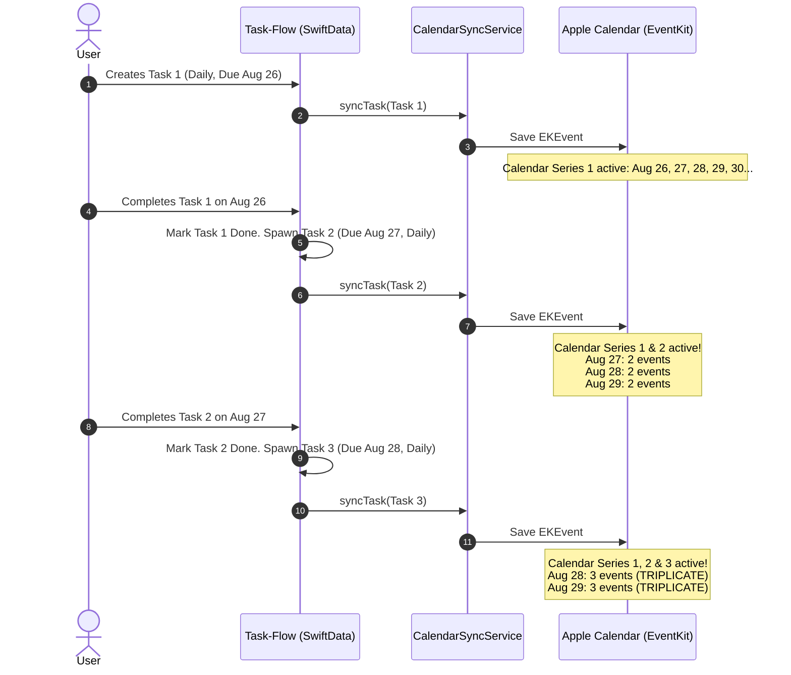

# Audit Module 02: Business Logic, Sync & Data Integrity
**Repository**: Task-Flow  
**Path**: `/Users/eduardotorres/Developer/XCodes/Task-Flow`  
**Audit Date**: August 26, 2026  
**Auditor**: Antigravity Principal Security & Software Systems Architect  
**Scope**: Recurrence Lifecycle, EventKit Synchronization, Task Successor Pointers, Natural Language Parser  

---

## 1. Executive Summary

This module examines core business logic, task state transitions, recurrence advancement, and external calendar synchronization.

The investigation uncovered **1 CRITICAL VULNERABILITY (`CRIT-01`)** that leads to severe calendar duplication in the user's Apple Calendar, alongside **1 MEDIUM INTEGRITY ISSUE (`MED-04`)** affecting task restoration chains.

---

## 2. Detailed Findings

### [CRIT-01] Dual Recurrence Mapping Spawns Overlapping Duplicate Series in Apple Calendar
- **Severity**: 🚨 **CRITICAL**
- **Location**: [`Services/CalendarSyncService.swift:88-93`](file:///Users/eduardotorres/Developer/XCodes/Task-Flow/Services/CalendarSyncService.swift#L88-L93), [`ViewModels/InboxViewModel.swift:211-222`](file:///Users/eduardotorres/Developer/XCodes/Task-Flow/ViewModels/InboxViewModel.swift#L211-L222)
- **CWE**: CWE-400 (Uncontrolled Resource Consumption / Data Pollution)
- **Status**: 🚨 **OPEN / ACTIVE**

#### Root Cause Analysis
Task-Flow manages task repetition through **discrete task materialization**:
1. When a recurring task is completed, `InboxViewModel.completeRecurring(task)` marks the current task as completed in SwiftData and calls `task.makeNextOccurrence()`.
2. `makeNextOccurrence()` generates a brand-new `Task` entity (`next`) with an advanced due date and assigns `next.recurrenceRule = task.recurrenceRule`.
3. `InboxViewModel` then executes `await calendarManager.syncTask(next)`.

However, in `CalendarSyncService.swift:88-96`:
```swift
let saveSpan: EKSpan
if let rule = task.recurrenceRule {
    ekEvent.recurrenceRules = [Self.ekRecurrenceRule(from: rule)]
    saveSpan = .futureEvents
} else {
    saveSpan = .thisEvent
}

do {
    try store.save(ekEvent, span: saveSpan)
    task.eventKitIdentifier = ekEvent.eventIdentifier
}
```

When `syncTask(task)` is called for the first recurring task (e.g. "Daily Standup" starting Aug 26), `CalendarSyncService` attaches an `EKRecurrenceRule` to the `EKEvent` and saves with `.futureEvents`. In Apple Calendar / EventKit, an event with `EKRecurrenceRule` automatically projects recurring occurrences indefinitely into the future.

When the user marks Occurrence #1 as done in Task-Flow:
- Occurrence #2 is created in SwiftData for Aug 27, carrying `recurrenceRule`.
- `CalendarSyncService.sync(task:)` creates a **second** `EKEvent` in EventKit, also attaching `EKRecurrenceRule` starting Aug 27.
- **Apple Calendar now contains TWO active recurring series**:
  - Series 1: Aug 26, Aug 27, Aug 28, Aug 29...
  - Series 2: Aug 27, Aug 28, Aug 29, Aug 30...
- When Occurrence #2 is completed, Occurrence #3 is created and synced, generating a **third** active recurring series in Apple Calendar.

#### Sequence Diagram of Calendar Pollution



#### Why Commit `c116623` Did Not Solve This
Commit `c116623` decoupled recurrence rules to prevent throwing when `recurrenceRules = nil` was paired with `.thisEvent`. However, because Task-Flow's core domain model materializes every occurrence as an independent `Task` row in SwiftData upon completion, projecting that model into EventKit requires syncing discrete individual `EKEvent` items without repeating series rules (`ekEvent.recurrenceRules = nil`).

#### Required Remediation
Because Task-Flow itself advances recurring tasks on completion, calendar mirrors must be discrete point-in-time events (`.thisEvent` without `EKRecurrenceRule`):

```diff
--- a/Services/CalendarSyncService.swift
+++ b/Services/CalendarSyncService.swift
@@ -72,27 +72,11 @@ import os.log
-        // Recurrence is handled independently of the scalar fields above.
-        //
-        // A recurrence rule describes the whole series, so writing or removing
-        // one must be saved with `.futureEvents`; EventKit rejects a recurrence
-        // change saved with `.thisEvent`.
-        let saveSpan: EKSpan
-        if let rule = task.recurrenceRule {
-            ekEvent.recurrenceRules = [Self.ekRecurrenceRule(from: rule)]
-            saveSpan = .futureEvents
-        } else {
-            saveSpan = .thisEvent
-        }
+        // Task-Flow materializes discrete Task records in SwiftData upon completion
+        // of each occurrence. Mirroring requires saving discrete single events in
+        // EventKit without attached recurrence rules to avoid duplicate series.
+        ekEvent.recurrenceRules = nil
+        let saveSpan: EKSpan = .thisEvent
 
         do {
             try store.save(ekEvent, span: saveSpan)
```

---

### [MED-04] Broken Successor Pointer Chain (`spawnedSuccessorID`) on Manual Task Deletion
- **Severity**: 🟡 **MEDIUM**
- **Location**: [`ViewModels/InboxViewModel.swift:235-254`](file:///Users/eduardotorres/Developer/XCodes/Task-Flow/ViewModels/InboxViewModel.swift#L235-L254), [`Views/Tasks/TaskEditView.swift:76-80`](file:///Users/eduardotorres/Developer/XCodes/Task-Flow/Views/Tasks/TaskEditView.swift#L76-L80)
- **CWE**: CWE-672 (Operation on Resource After Expiration or Release)
- **Status**: ⚠️ **OPEN**

#### Technical Analysis
When a recurring task `A` is completed, its spawned occurrence `B` is created and `A.spawnedSuccessorID = B.id`.
If the user opens task `B` in `TaskEditView` and deletes it:
1. `modelContext.delete(B)` deletes entity `B` from SwiftData.
2. `A.spawnedSuccessorID` continues to hold `B.id` (dangling UUID reference).
3. If the user later opens the **Done** screen and taps "Restore" on task `A`:
   - `InboxViewModel.toggleCompletion(A)` invokes `removeSpawnedSuccessor(of: A)`.
   - `removeSpawnedSuccessor` attempts to fetch `#Predicate { $0.id == A.spawnedSuccessorID }`.
   - Because `B` was already deleted, the query returns `nil` and the function returns immediately.
   - If `B` had already been completed and spawned `C` prior to being deleted, task `C` remains orphaned in the Inbox, leading to unexpected duplicate task occurrences.

#### Concrete Remediation
Ensure any task deletion cleans up inverse predecessor pointers:

```swift
func deleteTaskAndCleanPrecursors(_ task: Task, in context: ModelContext) {
    let taskID = task.id
    var descriptor = FetchDescriptor<Task>(predicate: #Predicate { $0.spawnedSuccessorID == taskID })
    descriptor.fetchLimit = 1
    if let precursor = try? context.fetch(descriptor).first {
        precursor.spawnedSuccessorID = nil
    }
    context.delete(task)
}
```

---

## 3. NaturalLanguageParser & IntelligenceEnricher Validation

1. **Word-Boundary Matching (`\b`)**:
   [`NaturalLanguageParser.swift:86-100`](file:///Users/eduardotorres/Developer/XCodes/Task-Flow/Services/NaturalLanguageParser.swift#L86-L100) utilizes compiled word-boundary regular expressions:
   - High Priority: `#"\b(?:urgent|asap|critical|high priority)\b"#`
   - Medium Priority: `#"\b(?:important|must|need to)\b"#`
   - Low Priority: `#"\b(?:low priority|whenever|someday|no rush|eventually)\b"#`
   This correctly avoids token sub-match corruption (e.g. "mustard" retaining "must", "critically" retaining "critical").

2. **Date Extraction Determinism**:
   `NSDataDetector` is used synchronously and deterministically for relative and absolute temporal expressions without network latency.

3. **Metadata Extraction via `IntelligenceEnricher`**:
   - `NLTagger` with `.nameType` identifies locations (`.placeName`) and attendees (`.personalName`).
   - Duration regex `#"(\d+)\s*(min(?:utes?)?|hr?s?|hours?)"#` accurately scales minutes (x60) and hours (x3600) for calendar event time windows.
