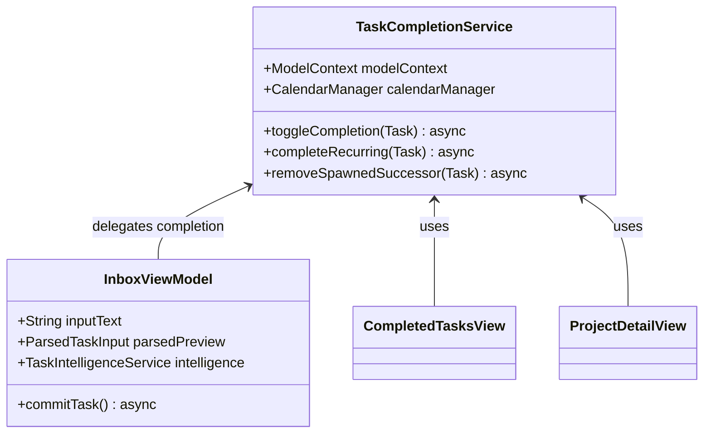

# Audit Module 04: Architecture & Design Patterns
**Repository**: Task-Flow  
**Path**: `/Users/eduardotorres/Developer/XCodes/Task-Flow`  
**Audit Date**: August 26, 2026  
**Auditor**: Antigravity Principal Security & Software Systems Architect  
**Scope**: MVVM Architecture, `@Observable` Integration, Swift 6 Strict Concurrency, Single Responsibility Principle, SwiftUI View Lifecycles  

---

## 1. Executive Summary

Task-Flow adopts a modern MVVM architecture leveraging Swift 6 `@Observable` macro bindings, `@MainActor` isolation, and strict concurrency checking (`SWIFT_STRICT_CONCURRENCY: complete`).

### Architectural Strengths Verified:
- **Dependency Graph Management**: `AppServices` (`App/TaskFlowApp.swift`) constructs the interdependent service graph lazily once, injecting instances via SwiftUI `.environment` modifiers.
- **Strict Concurrency Safety**: Realtime audio callbacks (`AVAudioNodeTapBlock`) and TCC authorization handlers in `VoiceTaskService` are factored into `nonisolated static` methods to eliminate runtime `SIGTRAP` executor traps.

### Identified Architectural Deficiencies:
- **[MED-02] OPEN**: Lazy `@State` ViewModel initialization in `.onAppear` causing layout pop-in and double render passes.
- **[MED-03] OPEN**: Single Responsibility Principle (SRP) violation on `InboxViewModel`.

---

## 2. Detailed Architectural Findings

### [MED-02] Lazy `@State` Optional ViewModel Initialization in `.onAppear`
- **Severity**: 🟡 **MEDIUM**
- **Location**: [`Views/Inbox/SmartInboxView.swift:40,84-86`](file:///Users/eduardotorres/Developer/XCodes/Task-Flow/Views/Inbox/SmartInboxView.swift#L40), [`Views/Completed/CompletedTasksView.swift:30,56-58`](file:///Users/eduardotorres/Developer/XCodes/Task-Flow/Views/Completed/CompletedTasksView.swift#L30), [`Views/Projects/ProjectDetailView.swift:22,70-72`](file:///Users/eduardotorres/Developer/XCodes/Task-Flow/Views/Projects/ProjectDetailView.swift#L22)
- **CWE**: CWE-1076 (Code Quality / Architectural Anti-Pattern)
- **Status**: ⚠️ **OPEN**

#### Technical Analysis
In `SmartInboxView`, `CompletedTasksView`, and `ProjectDetailView`, view models are declared as optional `@State` properties:
```swift
@State private var viewModel: InboxViewModel?

.onAppear {
    if viewModel == nil {
        viewModel = InboxViewModel(modelContext: modelContext, calendarManager: calendarManager)
    }
}
```
In `SmartInboxView.swift:64-67`:
```swift
if let vm = viewModel {
    NaturalLanguageInputBar(viewModel: vm)
        .padding(.bottom, 16)
}
```
During the initial SwiftUI body evaluation, `viewModel` is `nil`. Consequently, `NaturalLanguageInputBar` is excluded from the initial layout pass. When `.onAppear` fires, `viewModel` is assigned, triggering an immediate second layout pass and causing a noticeable visual pop-in (layout shift).

#### Recommended Pattern
Construct the view model deterministically or pass dependencies directly into custom view initializers using `State(wrappedValue:)`:
```swift
@State private var viewModel: InboxViewModel

init(modelContext: ModelContext, calendarManager: CalendarManager) {
    _viewModel = State(wrappedValue: InboxViewModel(modelContext: modelContext, calendarManager: calendarManager))
}
```

---

### [MED-03] Single Responsibility Principle (SRP) Violation in `InboxViewModel`
- **Severity**: 🟡 **MEDIUM**
- **Location**: [`ViewModels/InboxViewModel.swift:177-254`](file:///Users/eduardotorres/Developer/XCodes/Task-Flow/ViewModels/InboxViewModel.swift#L177-L254), [`Views/Completed/CompletedTasksView.swift:57`](file:///Users/eduardotorres/Developer/XCodes/Task-Flow/Views/Completed/CompletedTasksView.swift#L57), [`Views/Projects/ProjectDetailView.swift:72`](file:///Users/eduardotorres/Developer/XCodes/Task-Flow/Views/Projects/ProjectDetailView.swift#L72)
- **Status**: ⚠️ **OPEN**

#### Technical Analysis
`InboxViewModel` is responsible for:
1. Managing the live text input and preview state for `NaturalLanguageInputBar`.
2. Driving `NaturalLanguageParser` and `TaskIntelligenceService` cataloging.
3. Managing task completion state toggling, recurrence advancement, and successor deletion.

`CompletedTasksView` and `ProjectDetailView` instantiate full `InboxViewModel` instances exclusively to call `viewModel.toggleCompletion(task)`. This creates unnecessary coupling across unrelated screens to the NLP parser and Apple Intelligence services.

#### Recommended Architecture: Domain Service Extraction
Extract completion and recurrence logic into a dedicated domain service:



---

## 3. Swift 6 Strict Concurrency & Actor Boundary Analysis

### 1. Framework Callback Isolation (`SIGTRAP` Prevention)
In Swift 6, closures written inline inside `@MainActor` classes inherit main actor isolation. If a system framework invokes that closure from an arbitrary background queue or realtime thread, Swift runtime emits an executor assertion trap (`SIGTRAP`).

Task-Flow handles this with exemplary design in `VoiceTaskService.swift`:
- `requestSpeechAuthorization()`: Annotated as `nonisolated static` to receive TCC callbacks from `com.apple.root.default-qos` safely.
- `makeTapBlock(...)`: Annotated as `nonisolated static` to allow `AVAudioEngine` realtime audio threads to execute without asserting main-actor affinity.

### 2. Sendable Types
All data-transfer and model-adjacent types (`TaskCatalog`, `RecurrenceRule`, `Weekday`, `WidgetSnapshot`, `WidgetTask`, `WidgetProject`) conform strictly to `Sendable`.
