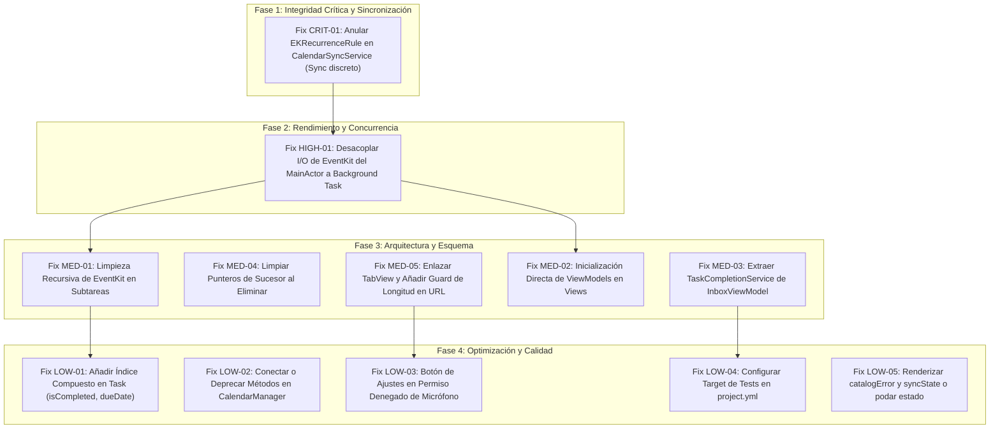

# Master Audit Verification & Remediation Checklist
**Repositorio**: Task-Flow  
**Ruta**: `/Users/eduardotorres/Developer/XCodes/Task-Flow`  
**Fecha de Auditoría**: 24 de Agosto de 2026  
**Auditor**: Antigravity Senior Security & Software Architect  

---

## 1. Resumen Ejecutivo (Executive Summary)

Este reporte consolida el estado global de todos los hallazgos de la auditoría técnica de **Task-Flow**, presentando una **hoja de ruta de remediación priorizada en 4 fases** y una lista de verificación detallada para asegurar la integridad, rendimiento y estabilidad del sistema.

---

## 2. Matriz de Estado de Módulos de Auditoría

| Módulo | Categoría Evaluada | Alcance Auditado | Estado y Hallazgos |
| :--- | :--- | :--- | :---: |
| **01** | **Seguridad y Privacidad** | Permisos TCC, Sandboxing, Deep Links, IA y Dictado | ✅ **HIGH-02 Resuelto**, 🟡 1 MED, 🔵 1 LOW |
| **02** | **Lógica de Negocio y Datos** | Recurrencia, Sincronización EventKit, Sucesores, NLP | 🚨 **1 CRITICAL** (`CRIT-01`), 🟡 1 MED (`MED-04`) |
| **03** | **Esquema de Base de Datos** | Modelos SwiftData, Relaciones, Cascada, Índices | 🟡 **1 MEDIUM** (`MED-01`), 🔵 1 LOW (`LOW-01`) |
| **04** | **Arquitectura y Patrones** | MVVM `@Observable`, Swift 6 Concurrency, SRP, Lifecycles | 🟡 **2 MEDIUM** (`MED-02`, `MED-03`) |
| **05** | **Rendimiento y Memoria** | I/O Sincrónico EventKit, Snapshots en Background | ✅ **HIGH-03 Resuelto**, 🔴 **1 HIGH** (`HIGH-01`) |
| **06** | **Código Muerto y Calidad** | Métodos No Invocados, Estado Huérfano, Tests | 🔵 **3 LOW** (`LOW-02`, `LOW-04`, `LOW-05`) |

---

## 3. Hoja de Ruta Priorizada de Remediación

---

## 4. Checklist de Verificación y Plan de Acción

### Fase 1: Integridad Crítica de Datos (Inmediato)
- [ ] **Fix CRIT-01**: En [`Services/CalendarSyncService.swift:88-93`](file:///Users/eduardotorres/Developer/XCodes/Task-Flow/Services/CalendarSyncService.swift#L88-L93), establecer `ekEvent.recurrenceRules = nil` y `saveSpan = .thisEvent`. Debido a que Task-Flow materializa cada repetición como un `Task` individual en SwiftData, añadir `EKRecurrenceRule` a `EKEvent` produce series recurrentes superpuestas exponenciales en Apple Calendar.

### Fase 2: Rendimiento y Concurrencia (Corto Plazo)
- [ ] **Fix HIGH-01**: Desacoplar llamadas a `EKEventStore.save`, `remove` y `events(matching:)` del `@MainActor` mediante tareas en background (`Task.detached(priority: .utility)`) para evitar bloqueos del hilo principal e IPC freezes.

### Fase 3: Arquitectura y Esquema (Mediano Plazo)
- [ ] **Fix MED-01**: Actualizar el flujo de eliminación de tareas en [`Views/Tasks/TaskEditView.swift:76-80`](file:///Users/eduardotorres/Developer/XCodes/Task-Flow/Views/Tasks/TaskEditView.swift#L76-L80) para desincronizar recursivamente los eventos en EventKit de todas las `subtasks` antes de ejecutar `modelContext.delete(task)`.
- [ ] **Fix MED-04**: Al eliminar una tarea sucesora en `TaskEditView`, limpiar la propiedad `spawnedSuccessorID` de su tarea precursora para evitar punteros rotos al restaurar la tarea original.
- [ ] **Fix MED-05**: En [`Views/Components/RootTabView.swift:19-26`](file:///Users/eduardotorres/Developer/XCodes/Task-Flow/Views/Components/RootTabView.swift#L19-L26), enlazar `TabView` a una selección reactiva y cambiar a la pestaña Inbox al recibir un Deep Link; añadir guard de longitud en [`Shared/TaskFlowSharedStore.swift:145-149`](file:///Users/eduardotorres/Developer/XCodes/Task-Flow/Shared/TaskFlowSharedStore.swift#L145-L149).
- [ ] **Fix MED-02**: Reemplazar view models opcionales `@State` en `SmartInboxView`, `CompletedTasksView` y `ProjectDetailView` por inicialización directa no opcional.
- [ ] **Fix MED-03**: Extraer la lógica de toggle de completado y gestión de recurrencia de `InboxViewModel` a un servicio de dominio (`TaskCompletionService`).

### Fase 4: Calidad y Optimización (Largo Plazo)
- [ ] **Fix LOW-01**: Añadir `#Index<Task>([\.isCompleted, \.dueDate])` en [`Models/Task.swift:15`](file:///Users/eduardotorres/Developer/XCodes/Task-Flow/Models/Task.swift#L15).
- [ ] **Fix LOW-02**: Conectar o deprecar métodos no invocados en [`Services/CalendarManager.swift:168-250`](file:///Users/eduardotorres/Developer/XCodes/Task-Flow/Services/CalendarManager.swift#L168-L250) (`syncAllTasks`, `importCalendarEvents`, `detectConflicts`).
- [ ] **Fix LOW-03**: Mostrar acción de redirección a Ajustes en [`Views/Components/VoiceInputButton.swift:47-48`](file:///Users/eduardotorres/Developer/XCodes/Task-Flow/Views/Components/VoiceInputButton.swift#L47-L48) ante permisos de micrófono denegados.
- [ ] **Fix LOW-04**: Configurar el target `Task-FlowTests` en [`project.yml:19-61`](file:///Users/eduardotorres/Developer/XCodes/Task-Flow/project.yml#L19-L61).
- [ ] **Fix LOW-05**: Renderizar mensajes de `catalogError` y `syncState` en la interfaz de usuario de `SmartInboxView` o eliminar el estado huérfano.
